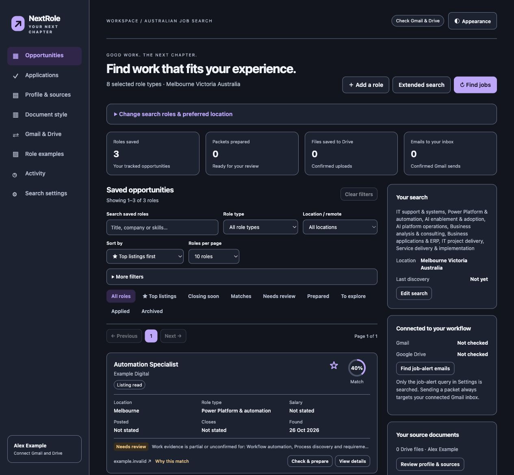

# NextRole

NextRole matches your saved experience to job requirements and explains the fit.<br>
It prepares résumé and cover-letter PDFs from confirmed evidence for your review.<br>
You stay in control: it does not submit applications to employers.


*Actual app capture with synthetic sample data; no connected accounts or live listings. [Screenshot details](assets/README.md).*

## Try it on your Mac

Requires **macOS and Python 3.12+**. Download and extract the [latest Mac release](https://github.com/fuzzwin/nextrole/releases/latest), then open **setup/START HERE.html** for guided setup. Older release ZIPs keep that guide at the top level.

From a source checkout:

```bash
git clone https://github.com/fuzzwin/nextrole.git
cd nextrole
./Start\ NextRole.command
```

The launcher creates a local Python environment, installs the pinned dependencies,
and opens the workspace at `http://127.0.0.1:8877/`. Keep Terminal open;
Control+C stops the site. Launch the same file to return to your workspace.

Start with your confirmed profile and a pasted role. Review the match explanation,
missing evidence and generated documents before using them. The package starts
blank, with automatic discovery, email delivery and application tracking disabled.

Optional connected search, Gmail and Drive need your own supported Codex connections.
A ChatGPT login alone does not guarantee those tools are available. You can edit a
profile and prepare pasted roles locally without connecting accounts.

## What it does

- Matches roles against saved facts and shows evidence gaps.
- Prepares Focused or Complete résumés and a cover letter or brief introduction.
- Keeps personal projects distinct from employment experience.
- Offers document layout choices and a sample-review step before optional delivery.
- Organises saved roles with filters, sorting and review status.

Generated PDFs need factual and application-instruction review. Résumé import is
conservative and layout-dependent; confirm the extracted profile before use.
Automatic delivery requires current sample approval plus enabled preferences.
Changes to the profile, style or sample invalidate approval. Approval alone does
not enable email or restart a schedule. NextRole never applies to jobs for you.

[User guide](docs/USER-GUIDE.md) · [Evidence and tailoring](docs/ROLE-TAILORING.md) · [Privacy](PRIVACY.md)

## How it works

A local Python/FastAPI app stores the workspace on your Mac. Matching uses local
evidence rules; tailoring selects saved facts and uses grounded templates.
ReportLab produces the PDFs. The connected workspace itself makes no LLM inference
requests; optional account tools are accessed through Codex app-server. A separate
Codex chat or scheduled run uses the model selected there.

This is a personal project built with AI coding tools and a Mac source release,
not a signed/notarized app or hosted service. Connector availability and experimental
app-server interfaces can change. Local scheduled runs need an awake, online Mac.
Windows and Linux are outside this release.

## Repository guide

| Location | Purpose |
| --- | --- |
| `campus_agent/` | Local app, evidence matching, document generation and optional connectors |
| `docs/` | User, tailoring and legacy CLI guides |
| `setup/` | Offline setup guide, copyable prompt and compatibility/demo launchers |
| `scripts/` | Guide generation and audited release packaging |
| `tests/` | Synthetic fixtures and regression checks |
| `assets/` | Public branding and synthetic-data screenshot |
| `Start NextRole.command` | Main Mac launcher |

The Python package retains `campus-job-agent` / `campus_agent` for compatibility.
The legacy launcher is now `setup/Start Job Seeker.command`; it forwards to the main
launcher. Existing used installations are not migrated by this source change.
The separate [legacy CLI and offline demo](docs/LEGACY-CLI.md) have optional
Gemini/SMTP/cloud settings that are not needed by the connected workspace.

## Development and clean releases

```bash
python3 -m venv .venv
.venv/bin/python -m pip install -r requirements-lock.txt
.venv/bin/python -m pip install -e '.[test]'
.venv/bin/python -m pytest -q
python3 scripts/build_release.py
```

The release builder produces `dist/NextRole-Mac-0.9.4.zip`, a manifest and a SHA-256
checksum from an explicit allowlist. It audits paths, symlinks, credential patterns
and approved binary assets. Share that clean ZIP, never a used workspace folder.
Do not commit profiles, documents, account state, logs, schedules or generated packets.
Tests use synthetic identities; live connector access needs separate verification.

## Licence

[MIT](LICENSE). Dependencies retain their own licences. Personal documents,
third-party listings and connected account data are not licensed by this repository.
