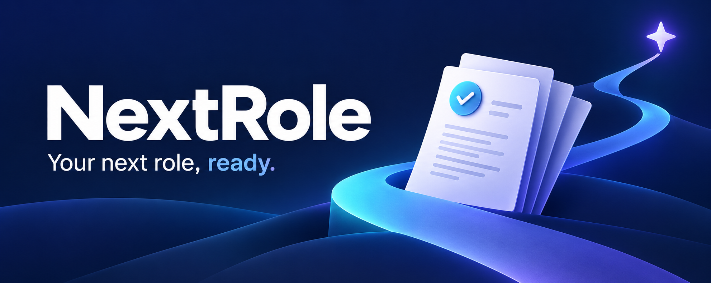

# NextRole



**Your next role, ready.** A local job-search workspace for Mac.

**Open `START HERE.html` for the offline setup guide.**

1. Start a **local Codex chat on your Mac** and attach the NextRole ZIP.
2. Attach your **current resume** (PDF or Word), or name your preferred Drive file.
3. Paste the setup message from **START HERE.html** or **CODEX SETUP PROMPT.txt**.
4. Let Codex unpack the project, check requirements and your own connections,
   launch the site, and show your extracted profile for confirmation.
5. Review a sample packet with sending disabled. Tomorrow, open the launcher
   in the folder Codex confirmed; no new chat is needed.

The guide includes checkpoints and a manual-folder fallback if ZIP attachments
or local permissions need help. Your resume is supplied separately in your own
setup chat; do not include it in the clean ZIP you share with other people.

Keep Terminal open; Control+C stops the site. Relaunch the same file tomorrow.
The package starts blank with automatic discovery/sending/tracking disabled.

NextRole searches Australian IT, automation, AI, business analysis, applications,
project delivery and service delivery roles. It explains experience/requirement
matches, supports Auto top listings, and prepares checked résumé/letter PDFs.
Saved roles use paginated lists (10/20/50), combined filters, sorting and a clear
result count. Each role explains the document guardrails and its check status.
Before automatic delivery, **Document style** lets each user choose PDF layout,
page limit, letter tone/detail and fact order, then preview and approve a sample
résumé and cover letter. Automatic emails remain blocked until current approval
is saved. Changes to profile/style/sample files invalidate approval. Sample
approval never enables an email preference or resumes a schedule by itself.
No employer applications are submitted.

## How GPT / Codex fit in

Python runs the site. Codex app-server supplies your connected tools. The
connected workspace makes no LLM inference requests: scoring uses local evidence
rules and tailoring ranks confirmed facts with a grounded letter template.
PDFs use ReportLab. A separate Codex chat or scheduled run uses the model selected
in Codex. No GPT model or API key is hardcoded into the connected workspace.

Each recipient must connect their own accounts and set up their own optional
schedules. A ChatGPT login alone does not guarantee the required connector tools
are available. New users can still edit profiles and prepare pasted roles locally.

[Full user guide](docs/USER-GUIDE.md) ·
[Official Codex CLI setup](https://learn.chatgpt.com/docs/codex/cli) ·
[Plugins](https://learn.chatgpt.com/docs/plugins) ·
[App-server](https://learn.chatgpt.com/docs/app-server)

## Dependencies and support

macOS and Python 3.12+ are required. Python packages are pinned in
`requirements-lock.txt` and installed automatically inside this folder.
No Docker, Google app password or API key is needed for the connected workflow.
This is a Mac source release, not a signed/notarized app or hosted service.
Windows/Linux are outside this release. Experimental app-server methods and
account-specific connector availability may affect compatibility after updates.
The Mac must be awake/online for local scheduled runs.

## Build a clean sharing ZIP

```bash
python3 scripts/build_release.py
```

Output: `dist/NextRole-Mac-0.8.2.zip`, a SHA-256 file and a file manifest.
The builder uses an explicit source allowlist and audits paths, symlinks and
common credential patterns. It does not read private workspace data. Share this
clean ZIP, not a used folder: your workspace, profile, PDFs, account state,
source documents, logs, evidence, credentials and schedules are excluded.

The older campus-board CLI and offline demo remain separate compatibility modes.
Their optional Gemini/SMTP/cloud settings are documented in `docs/LEGACY-CLI.md`
and are not needed for the connected NextRole. Historical evidence and Windows
scripts referenced there are not included in this Mac release.

## Development and privacy

The Python distribution/module retains `campus-job-agent` / `campus_agent` for
compatibility; the product is NextRole. Existing workspace folders and launchers
keep working. `Start Job Seeker.command` remains a compatibility launcher.

Run checks without calling connected services:

```bash
python3 -m venv .venv
.venv/bin/python -m pip install -r requirements-lock.txt
.venv/bin/python -m pip install -e '.[test]'
.venv/bin/python -m pytest -q
```

Read [PRIVACY.md](PRIVACY.md) before sharing a used installation. Tests use
synthetic identities. Do not commit your workspace, documents, credentials,
automation configuration or generated application packets.

## Licence

NextRole is available under the [MIT License](LICENSE). Dependencies retain
their own licences. No third-party job listing, personal document or connected
account data is licensed by this repository.
