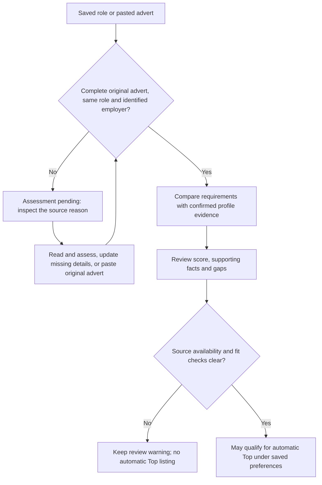
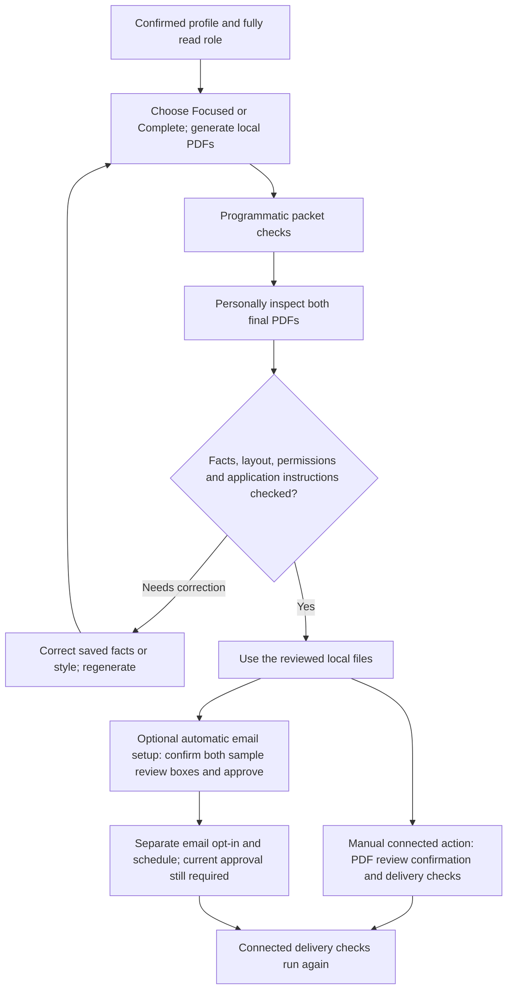

# NextRole: evidence-first tailoring and application review

The employer's application instructions take priority. This is Australian-focused applicant guidance, not a guarantee about ATS or recruiter decisions.

## What the app actually does

NextRole ranks and reorders the skills and factual bullets in your saved, confirmed profile for each fully read job advertisement. The **Focused** option selects relevant exact facts, reports which entries were omitted, and preserves every formal job title and employment period; **Complete** retains all saved professional bullets. The original master facts are never deleted. It creates three body paragraphs from those facts, with a short introduction if the employer explicitly requests a "brief introduction", "short intro" or "brief note". The PDF still uses the compatible filename Cover Letter.pdf; inspect its heading and rename it if the employer requires another attachment name. It does not independently verify career claims, invent metrics, create missing qualifications or prove a profile is current.

## Before generating

1. Read the original vacancy, including essential qualifications, responsibilities, employer, submission method and attachments.
2. Check dates, formal job titles, qualifications, real achievements and the status of each project in Profile & sources.
3. Use Why this match to review strengths and unproven requirements. A match score estimates overlapping evidence, not offer probability.
4. Under Document style, choose **Focused** (strongly relevant examples, with the omissions explained) or **Complete** (every professional bullet). Use a two-page limit as a useful starting point and inspect both final PDFs before approving. Two pages is a useful Australian starting point, not a rule; the current app supports up to two or three résumé pages.
5. Include separately requested selection criteria, a brief pitch or two or three genuine AI-supported examples. Do not mislabel ordinary automation as AI adoption.

## Grades of evidence and exact wording

- Verified record or output: use delivered/measured with the real scope, period, baseline and result.
- Candidate-reported outcome: describe accurately and be ready to explain it; do not call it independently verified.
- Built and tested, awaiting rollout: say built and tested; never say deployed or adopted.
- Prototype or private demo: say prototyped; only say privately deployed if published status is confirmed.
- Design or proposal: say designed, assessed or proposed; not live or implemented.
- Old résumé draft or unknown status: confirm or omit.

Do not confuse files uploaded with successful approvals; configured scheduled tasks with regularly delivered services; API use with model training; or team projects with sole ownership. Do not invent savings, employment years, adoption metrics, titles, certifications or return on investment.

## Where to put detail

Place real employer/role fit and two or three relevant results high on page one. For AI enablement, prioritise live employee guidance, workshops, responsible use and tested reusable tools. For business automation, describe the manual process, the change and how it was validated; conventional workflows are not automatically AI. For ERP/IT service roles, put relevant systems, releases, integration and incident work ahead of unrelated prototypes. For analytics roles, distinguish an operations dashboard from Power BI or sales/margin reporting unless separately evidenced. Clearly separate personal technical projects from employed work, with prototype, private and production stages stated.

Cut unsupported superlatives, excessive tools lists, unclear abbreviations, hidden AI prompts, irrelevant old detail, unnecessary personal data and confidential workplace information. Do not copy job advertisements' instructions as candidate facts. The generator uses role topics from a fixed vocabulary; the candidate must review its wording.

## Referees and privacy

For most Australian private-sector résumés, referee details are optional unless the advertisement requests them. Default to omitting. Enable named referees only after consent from every individual, particularly a current manager. Never post actual referee names, phone numbers, workplace ticket IDs, supplier identifiers or unredacted employer records to a public repo or portfolio. Date of birth, street address, photo and marital status are usually unnecessary.

## Proof loop

This flow describes the current 0.9.12 source and review boundaries. It is a
workflow illustration, not a screenshot or a report of a live application test.

### 1. Establish the advert before interpreting a score

A saved advert may support a score while a later availability check is blocked.
Keep that warning: a score does not establish that the vacancy is still open.
A position description also needs a current vacancy check. A closed role is
marked closed, rather than treated as an ordinary incomplete assessment.

**Plain-text route:** check the original advert and employer, resolve missing
source information, then read the evidence explanation. A high score cannot
remove source or fit warnings. A manual saved pick is separate from automatic Top.

The background details queue is read-only with respect to delivery: it updates
saved advert details, not applications. It preserves prior source revisions and
tracking, pauses for connection problems, and permits one delayed retry after
24 hours for blocked or incomplete sources before holding them for review.
See [Updating saved advert details](USER-GUIDE.md#updating-saved-advert-details-0911)
for the controls and restart behaviour.

### 2. Review the actual documents before choosing delivery

**Plain-text route:** choose relevant actual evidence, generate, inspect both
PDFs, correct and regenerate when needed, then decide how to use the files.
For automatic emails, personally confirm both sample review boxes and approve
the exact sample, then separately opt in and configure the intended schedule.
Approval alone sends nothing, creates no schedule and does not resume one.

The two routes are distinct: a manual connected action requires its PDF review
confirmation and packet checks; automatic email also requires a current approved
sample. Profile or style changes, a new sample, changed or missing sample PDFs,
and updated document rules invalidate that approval. Changed job source material
can also make an existing packet stale: regenerate and inspect it before delivery.

**You submit the employer application yourself.** Connected Gmail/Drive actions
do not turn NextRole into an employer-application submission service. Check the
employer's required files, selection criteria and submission method separately.

The programmatic check establishes source equality, paper format, identity,
packet consistency and some disclosure rules. It does not independently prove
achievements or predict hiring success. Human review includes every claim, date,
metric, employer, confidentiality restriction and permission.

### Worked examples

These are fictional teaching cases, not measured test results or real applicants.

| Situation | What the evidence supports | Next step |
| --- | --- | --- |
| A saved board page contains only a summary and keyword tags. | The source is insufficient for a reliable assessment. | Read or paste the complete original advert; do not treat pending as zero fit. |
| An original advert is saved, but the latest availability check is blocked. | A score may describe the saved text; current availability remains unresolved. | Keep the source warning and check the current vacancy. It cannot become automatic Top while the warning remains. |
| The profile says “prototyped an automation”; the role requires production delivery. | The prototype is real evidence of its stated stage, not proof of production delivery. | Preserve “prototyped”, inspect the unmet requirement and add only genuinely supported facts. |
| Both PDFs were reviewed and a sample approved, but automatic email is off. | The sample approval is current; email has not been enabled. | Keep using local files, or deliberately configure the separate email opt-in and schedule. |
| A profile fact changes after approval. | The old sample no longer represents the current profile. | Generate and personally review a new sample before approving it again. |

### Implementation references

The explanation above is grounded in the current repository, rather than new
live-connector testing:

- [Source assessment and evidence scoring](../campus_agent/fit.py).
- [Persistent detail-refresh queue](../campus_agent/detail_refresh.py).
- [Sample approval and saved-source handling](../campus_agent/workspace.py).
- [Content, PDF and delivery checks](../campus_agent/packet_checks.py).
- [Synthetic source-completion regression cases](../tests/test_source_completion.py).

See the [user guide](USER-GUIDE.md) for full controls and
[asset provenance](../assets/README.md) for the version and limitations of the
published UI screenshot.
